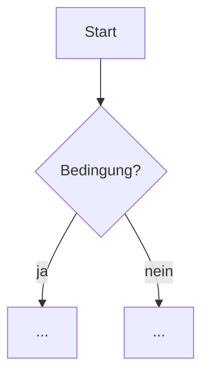

Erkläre folgenden Code: $ARGUMENTS

Kein Argument angegeben → frage: Welche Datei, Funktion oder welches Konzept soll erklärt werden?

Lies zuerst alle relevanten Dateien — nie ohne den vollen Kontext erklären.

**Sprache: Deutsch. Immer.**
Zielgruppe: Absolute Beginner. Kein Vorwissen voraussetzen. Jeder Fachbegriff wird beim ersten Auftreten sofort erklärt.

<thinking>
Vor der Erklärung intern analysieren:

**Was macht der Code wirklich?**
- Nicht was er *soll* — was tut er *tatsächlich*, Schritt für Schritt?
- Welches Problem löst er konkret?

**Schwierigkeitsgrad einschätzen:**
- Beginner: Variablen, Schleifen, einfache Funktionen
- Intermediate: Async, Callbacks, Klassen, State
- Advanced: Design Patterns, Closures, Metaprogramming, komplexe Typen

**Welche Konzepte stecken drin?**
- Liste alle nicht-trivialen Konzepte auf
- Was muss man verstehen, bevor man diesen Code versteht?
- In welcher Reihenfolge erklären, damit es logisch aufbaut?

**Beste Analogie finden:**
- Was kennt ein absoluter Beginner aus dem Alltag, das diesem Konzept ähnelt?
- Analogie muss 1:1 auf das Konzept passen — keine halb-passenden Vergleiche

**Stolperfallen:**
- Was würde ein Beginner hier falsch verstehen?
- Welche Annahmen macht der Code, die nicht offensichtlich sind?
- Gibt es Seiteneffekte, die man nicht sofort sieht?
</thinking>

## Output

---

### Auf einen Blick

**Was macht dieser Code?** — Ein Satz, verständlich für jemanden der noch nie programmiert hat.

**Schwierigkeitsgrad:** Beginner / Intermediate / Advanced

**Dafür brauchst du vorher:** Liste der Voraussetzungen (z.B. "du weißt was eine Funktion ist")

---

### Konzepte erklärt — bevor wir anfangen

Jeden Fachbegriff im Code zuerst isoliert erklären, bevor er im Kontext auftaucht:

**[Konzeptname]**
→ *Was ist das auf Deutsch in einem Satz?*
→ *Analogie aus dem Alltag:* "Stell dir vor..."
→ *Im Code bedeutet das konkret:* ...

*(Einen Block pro Konzept. Keine Abkürzungen.)*

---

### Schritt-für-Schritt Durchgang

Den Code Zeile für Zeile (oder Block für Block) durchgehen.

Format pro Schritt:
```
[Zeile / Block]
```
**Was passiert hier:** klare deutsche Erklärung
**Warum ist das so:** Begründung, nicht nur Beschreibung
**Analogie (falls hilfreich):** ...

Bei komplexem Kontrollfluss → Mermaid Diagramm einfügen:


---

### Das übersieht man leicht

Dinge die nicht offensichtlich sind — die ein Beginner garantiert falsch versteht:

**[Thema]**
**Falsche Annahme:** ...
**Was wirklich passiert:** ...

---

### Typische Fehler

Was geht schief, wenn man diesen Code falsch verwendet oder verändert:

| Fehler | Warum passiert er | Wie vermeiden |
|--------|------------------|---------------|
| ... | ... | ... |

---

### Minimales Beispiel

Den Kern-Mechanismus in ~10-20 Zeilen isoliert zeigen — ohne alles drumherum:

```ts
// Minimal-Beispiel: nur das Wesentliche
```

**Was dieses Beispiel zeigt:** ...
**Was es weglässt (und warum das okay ist):** ...

---

### Zusammenfassung

3-5 Bullet Points — das Take-Away wenn man nur das liest:
- ...
- ...
- ...

Erklärungstiefe an Komplexität anpassen — simpler Code bekommt eine simple Erklärung, kein künstliches Aufblähen.